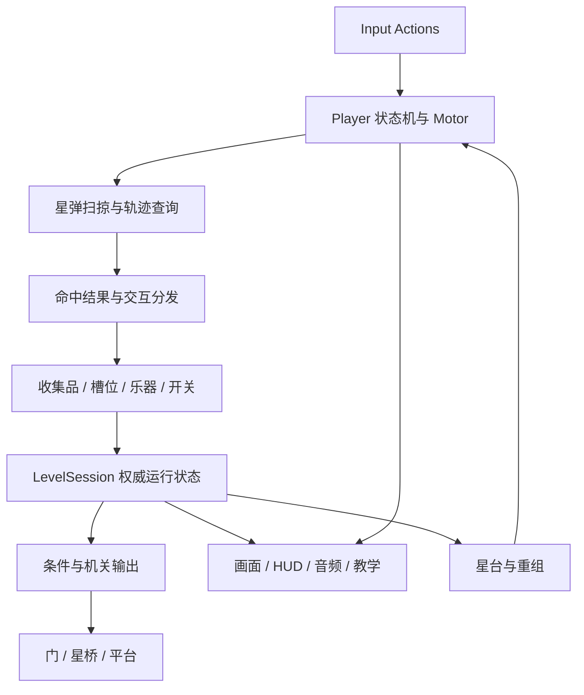
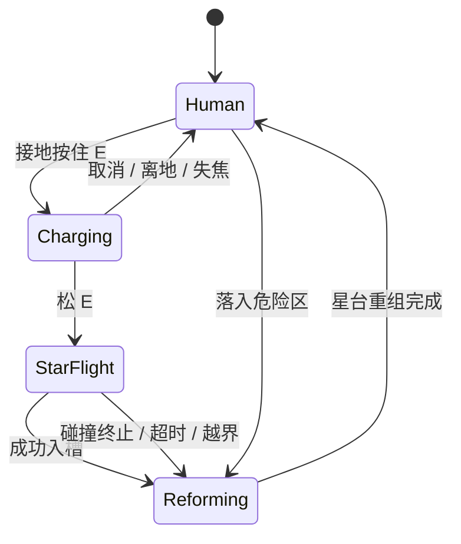

# 整体架构与落地路线

日期：2026-11-04。依据：[策划 V1.0](重生之我在希腊撞撞撞.md)。本文是实施方案；新增规则均标为制作基线，不改写原案。

实施状态（2026-11-04）：M0/M1 的程序与核心灰盒运行门槛已完成，独立场景为 `Assets/Game/Scenes/Chapter01_Core.unity`。完整 P0 风格/音频交付、M2 及正式关卡尚未完成；实际产出、旧工作取舍和测试证据见[开发进度](04-开发进度.md)。本方案其余系统仍是制作要求，不能将表内命名视为已实现功能。

## 1. 现有工作是否需要推翻

**不需要重建 Unity 工程；需要重构玩家玩法层，并重新设计正式关卡。** 现有内容还是轻量原型，尚无需要迁移的大规模关卡、任务或存档系统。在同一工程内增加新玩法比重开项目更合适，也能保留已经验证过的相机控制思路。

最初规划只增加文档与本地约定，保留 `main`。代码实施现已另建 `feat/chapter01-starshot`，以增量方式完成 M0/M1，并保留既有未提交工作。

### 1.1 实施前的核查依据

- 工程版本 `6000.0.84f1`；URP `17.0.4`，管线资产使用 `Renderer2D`；已有 Input System `1.20.0`、uGUI `2.0.0` 和 Test Framework。
- `PlayerMovement2D` 只读取 A/D，在固定更新中直接设置水平速度 `4.4`，带重力，没有跳跃、蓄力或发射状态。直接继续往这个脚本叠加所有机制会造成状态和速度写入冲突。
- `CameraFollow2D` 已有左右锚点、低位构图、死区和逐帧不越过当前目标的约束；`LevelBounds2D` 已有矩形地图裁剪。旧相机文档的保证仅针对当帧焦点，不能当成瞬移、缩放与高速飞行已经验证。
- `Northline.unity` 是平地、边界、格线与方块角色的实验场；构建列表还包含模板 `SampleScene`。没有发现正式关卡或完整机关链。
- `MapReveal2D` 已有 `RecordPending` / `IlluminatePending` / `RevealAt` 和按通道存储的 pending 队列，但仍在内部采样玩家位移。可复用事件思想，不能声称已经完全解耦。
- `DistanceFootstepEmitter2D` 当前工作区版本按移动中的时间间隔发声，名称仍保留 Distance。`FootstepSound2D` 使用程序生成的占位声音，不能算成品音频。
- `PlatformerSceneBuilder.BuildScene()` 会删除旧原型根节点及指定 Art 目录，并修改构建列表、保存场景。它不能作为正式关卡的日常编辑工具。
- WSL 有三个既存未提交修改：`MapRevealFog.shader`、`DistanceFootstepEmitter2D.cs`、`MapReveal2D.cs`。Windows 副本有更多本地修改，HEAD 也更早；已比对的关键脚本文本一致，`Northline.unity` 不一致。本次不移动、覆盖或提交这些工作。

本评估来自源文件、序列化场景与两份工作区的只读核查，未运行 Editor 或 Play Mode，因此不构成运行效果验收。

### 1.2 保留、改造与新增

| 现有内容 | 决策 | 后续落地 |
| --- | --- | --- |
| Unity 6 + URP 2D 工程 | 保留 | 不升级引擎或渲染管线，不引入新物理系统 |
| `LevelBounds2D` | 复用 | 正式关卡配置自己的边界；补小房间与不同宽高比验证 |
| `CameraFollow2D` | 保留算法，扩展模式 | 增加人形/瞄准/飞行/重组模式和瞬移重置入口 |
| `PlayerMovement2D` | 新控制器替代正式关卡中的职责 | 原型中保留；正式 Player 只能有一个速度/位置写入者 |
| `DistanceFootstepEmitter2D` | 复用事件形式、适配状态 | 只在人形接地行走/推石时发出；传送与星弹不发脚步 |
| `FootstepSound2D` | 作为占位参考 | 新音频表现层使用导入素材和 Audio Mixer |
| `MapReveal2D` / shader | 保留实验功能，第一章默认不挂载 | 不把迷雾当必需玩法，不遮住瞄准目标和教学；未来启用仍需每个事件通道独立 pending |
| `SolidShape2D`、地面格线 | 灰盒工具 | 正式美术用 Sprite；格线只保留在编辑/调试视图 |
| `Northline` / Scratch / Sample 场景 | 保留 | 新建正式场景；发布构建仅包含正式入口与两关 |
| 机关、星影、进度、无文字教学 | 新增 | 按下面模块逐步实现，先打通完整闭环 |

## 2. 范围和需要补齐的规则

### 2.1 本期范围

原案确定：单人、二维横版、两关、每关目标 3–5 分钟。第一关教直接撞击、里拉反弹和星影平台；第二关组合星石、压板、星桥、手鼓和里拉。第一章要求三种乐器，其中排箫安排到第二关 E 区是本次补全。第二、三章、联网、战斗、经济系统不进入本期。

制作基线：先验证 Windows 桌面键鼠、1920×1080 参考画面和稳定 60 fps；另验 1280×720 与 16:10。平台尚未在原案中确定，Windows 是开发顺序选择，不代表已承诺其他平台。手柄/移动端不做首批交付，但 Input Actions 留出重绑定入口。

### 2.2 歧义处理表

| 原案缺口/歧义 | 本次制作基线 | 原因与验证 |
| --- | --- | --- |
| “按住 e’”及调整方向方式 | A/D 移动，Space 跳，按住 E 蓄力，鼠标瞄准，松 E 发射，右键取消蓄力；R 收回星影，Esc 暂停 | 先做键鼠，键位经 Input Actions 管理；暂停/失焦取消蓄力，不意外发射 |
| 蓄力改变什么 | 直线、无重力星弹；蓄力改变速度/有效距离，方向可自由瞄准；无蓄力消耗 | 便于预览和教学；具体数值经灰盒验证 |
| 空中能否蓄力 | 人形接地才能开始蓄力；蓄力时停止主动走跳，重力与平台承载仍生效；离地取消蓄力 | 降低状态复杂度，先保证两关可解；不增加空中无限续航 |
| 普通墙与里拉的反弹预算 | 每次发射共用一次反弹预算；普通实墙、里拉弦、手鼓鼓面均按法线反射并消耗一次 | 里拉额外点亮配对星纹，手鼓额外发鼓波；耗尽后撞实物即回星台，交互效果仍先结算 |
| 什么会结束飞行 | 入槽成功、第二次实物碰撞、飞行时间/距离耗尽、落入危险区或越界 | 收集片、星纹触发区、排箫管口和被击碎脆墙不消耗反弹；其事件和阻挡角色要分别定义 |
| 星影数量 | 同时最多一个；有星影仍可发射；占用星影额度时不能再嵌另一个槽，须先 R 收回 | 不悄悄自动撤掉脚下平台；锁定槽用闭合月桂图标表达 |
| 星影收回 | 任意可操控状态按 R，1 秒召回演出；演出完成才原子地清空占槽、撤碰撞体、更新机关；召回期间不能重复提交 | 采用原案“建议随时收回”；若撤去脚下平台导致掉落，按正常失败快速返回 |
| “最近星台” | 最近一次实际接触并激活的安全星台，非几何距离最近或尚未到达的星台 | 确保不会传到隔墙/未访问区域；入口有默认星台 |
| 失败保留哪些机关 | 保留碎片、一次性开关、碎墙、星台激活和最终出口解锁；压板、临时桥等持续条件始终实时计算 | 避免把所有“启动过”的临时机关永久锁开，破坏星影谜题 |
| 星影失败后是否保留 | 普通失败保留已放置星影；入槽后也保留；主动“重置当前谜题”会撤回 | 重组后才能利用星影，不能把它纳入普通失败清空项 |
| 第二关第一片碎片未安排 | A 区星石压板门后放 F1 | 使三片目标有明确来源 |
| 第二关只写了一个开关 | D 区里拉反弹点亮 S1；E 区排箫升台后撞 S2，并取得 F3 | 门条件确实为 F1/F2/F3 + S1/S2 |
| 三乐器固定但流程没有排箫 | E 区加入短排箫教学：撞带上箭纹的管口，升起平台，站上平台触达 S2/F3 | 只加一个清楚动作，避免引入音阶记忆游戏挤占关卡时长 |
| “无文字”的适用面 | 谜题表达、收集栏、门锁不靠文字；菜单/设置可有简短中文和可重绑键位字形 | 教学只靠壁画仍不足以知道 E/R；用动作图标搭配按键字形，不写解释段落 |
| 重启程序的进度 | 本期必做关卡内失败保留；跨启动只保存音量/画面等设置，不承诺自动续关 | 避免把会话状态和磁盘存档混为一谈；后续续关需单独定义版本化格式 |

这些是可修改的实施选择，尤其单星影、接地蓄力和反弹预算需要在 P0 样机中试玩。修改规则时同步修改轨迹预测、教学图、资产状态、音频事件和验收用例。

## 3. 整体技术架构

### 3.1 选择

- **场景与组件**：MonoBehaviour + 小型 C# 状态机；配置使用 ScriptableObject。每关一个组合根，直接持有依赖；先不用 ECS、依赖注入框架、通用节点编辑器或全局静态事件总线。
- **物理**：沿用 `UnityEngine.Rigidbody2D / Collider2D / Physics2D`。不迁移 Unity 6.7+ 的 Physics Core，也不混用 3D 物理。
- **人形**：Dynamic Rigidbody2D、FreezeRotation、低摩擦实体碰撞；固定步更新移动、跳跃与受控推石。角色 Sprite 翻转放在 Visual 子节点，碰撞根 scale 保持 1。
- **星弹**：同一 Player 根切换为 Kinematic，由专用球形扫掠求解器推进；人形实体碰撞在此状态关闭。碰撞、反弹和交互只由求解器结算，不同时靠弹性材质与碰撞回调再算一次。
- **画面**：URP 2D Renderer、正交相机、高清二维绘本/剪纸式 Sprite；少量 2D Light 和粒子作反馈。场景主体不依赖昂贵法线/动态阴影。
- **UI**：已有 uGUI 做小规模图形 HUD、暂停与音量设置；世界中的壁画、槽位、星座门使用 Sprite。此阶段不再引入第二套运行时 UI 框架。
- **音频**：AudioSource + AudioMixer，事件由玩法发布，音频层按事件映射素材，不反向控制机关结算。



图中箭头表示调用/通知方向。状态修改发生在玩法与 LevelSession，动画结束事件、音效播放完成或粒子生命周期不能决定是否开门、得分或复活。

### 3.2 模块职责和最小数据契约

以下为目标命名与职责，不表示所有文件已经存在。M0/M1 已实现输入、玩家/Motor、共享路径求解、F1/星台/会话与基础表现；完整机关和流程仍待后续阶段。为显式复用原型边界工具与运行测试，现已建立运行、Editor 和测试 asmdef。

| 模块 | 主要对象 | 职责与边界 |
| --- | --- | --- |
| 输入 | `PlayerInputReader` | 把 Actions 转为 Move、JumpPressed、ChargeHeld/Released、Aim、Recall、Pause；记录边沿输入，固定步消费一次 |
| 玩家 | `PlayerStateMachine`、`HumanoidMotor2D`、`StarFlightMotor2D` | 唯一的移动所有者；状态决定启用哪个 Motor、碰撞形状与重力；视觉不写刚体 |
| 轨迹 | `StarPathSolver`、`TrajectoryPreview` | 同一半径、过滤、法线和反弹规则；预览只读，不触发真实机关 |
| 命中 | `StarImpactResolver`、`IStarHittable` | 输入 `shotId / targetId / hitPoint / normal / incomingVelocity`；返回穿过、反射、嵌入或终止；不依靠物体名称辨认类型 |
| 星影 | `StarShadowController`、`StarSocket` | 管理唯一星影、占槽、召回计时、平台/压板占用贡献；使用明确槽位模式与引用 |
| 机关 | `PressurePlate`、`Lyre`、`Drum`、`PanFlute`、`BrittleWall`、`StarSwitch` | 局部行为组件；鼓波使用配置半径与明确目标组；里拉以引用连接同纹样接收器 |
| 条件 | `MechanismCondition` / `MechanismOutput` | Inspector 中显式配置 AND/OR 条件；压板持续信号与开关锁存信号分开；无需通用图系统 |
| 关卡状态 | `LevelSession` | 保存稳定 ID 集合和当前 checkpoint；发状态变化事件；使用 `TryCollect` / `TryActivate` 等幂等入口 |
| 复位 | `CheckpointController`、`PuzzleResetGroup` | 普通失败只重组玩家；重置谜题恢复该组星石/活动平台并清星影；二者不能混淆 |
| 表现 | `PlayerView`、`MechanismView`、`AudioFeedback`、`HudPresenter` | 只订阅状态与反馈事件；从权威状态刷新，不自建另一份碎片计数 |
| 流程 | `GameFlow`、`LevelBootstrap` | 正式关卡入口、暂停、重开、切关和设置；可直接打开单关进行调试 |

`PlayerTuning` 保存移动/跳跃/飞行/蓄力/收回参数；`LevelDefinition` 保存关卡 ID、所需碎片与开关 ID、下一关；`MechanismTuning`、`AudioCueLibrary`、`ArtPalette` 保存可复用配置。场景对象的空间关系和引用由场景/Prefab 配置，不把场景实例引用塞进跨场景共享资产。

ScriptableObject 只做配置，运行时状态存在 `LevelSession`，不在 Play Mode 修改资产以保存进度。Stable ID 为序列化的关卡内唯一标识，不能用数组序号、物体名称或运行时 instance ID；提供编辑期重复/缺失引用检查。

### 3.3 目录与场景落地

```text
Assets/Game/
  Runtime/{Player,Star,Mechanisms,Level,Presentation,Audio,UI}/
  Data/{Player,Levels,Mechanisms,Audio,Palette}/
  Prefabs/{Player,Mechanisms,Environment,Feedback,UI}/
  Art/{Characters,Environment,Mechanisms,UI,VFX,Tutorial}/
  Audio/{SFX,Music,Ambience,Mixers}/
  Scenes/{Bootstrap,Chapter01_01,Chapter01_02}.unity
  Tests/{EditMode,PlayMode}/
Assets/Platformer/                 # 现有原型；逐项复用，不整目录删除
```

每关层级采用 `LevelRoot / Geometry / Background / Mechanisms / Collectibles / Checkpoints / Tutorial / Actors / Presentation`。关卡作者在 Editor 中摆放 Prefab 和 Collider，1 unit 主网格、0.25 unit 辅网格。正式 scene 保存为新文件，不用旧生成器重建用户场景。复用旧类时直接引用现有命名空间；确需移动脚本时连 `.meta` 一起迁移，保持 GUID。

固定地面可使用模块化 Sprite + 手工 Box/Polygon/CompositeCollider2D；两关阶段先不投入自动 RuleTile 系统。机关 Prefab 分 Gameplay 根、Collision、Visual、VFXAnchor、AudioAnchor。美术替换 Visual 不改变碰撞、稳定 ID 或条件连线。

Bootstrap 管理菜单、设置和关卡切换；关卡卸载后释放订阅、声音循环和临时对象。启动单个关卡时也能建立本关依赖，避免只能从启动场景调试。

## 4. 关键玩法怎样实现

### 4.1 玩家状态与起始参数



暂停是独立的流程状态，冻结玩法时间和召回计时，保留 UI 输入。星影属于关卡对象，不是玩家的另一个可操控身体，不进入第二套玩家输入状态机。

暂停/失焦时取消蓄力，恢复后必须重新按 E；已发射的星弹在暂停期间冻结，恢复后继续。已经开始的召回由关卡计时器持有，普通失败重组不中断召回；当前谜题复位或切关则取消计时并直接清理。已有星影而撞入不可用槽时，槽按普通实体消耗反弹/终止飞行，播放一次不可嵌入提示，不重复叠普通墙击声。

| 参数 | 灰盒起始值 | 使用约束 |
| --- | --- | --- |
| 人形碰撞体 | 宽约 0.65、高约 1.35 unit | 美术可高 1.6 unit，头冠/披风不算碰撞；根 scale = 1 |
| 行走 | 沿用 4.4 unit/s 起测 | 保留响应直接的 A/D；推石速度单独限制为约 2.5 |
| 跳跃 | 高约 2.2 unit，单跳 | 由目标高度和重力推算初速度；接地宽限与输入缓冲各约 0.1 秒 |
| 蓄力 | 0–0.8 秒 | 未满也可发射；不得要求所有教学都精确满蓄 |
| 星弹 | 半径约 0.22 unit，速度 10–18 unit/s | 固定 50 Hz 起测，每步仍须扫掠；视觉金环可大于命中球 |
| 飞行上限 | 约 1.0 秒或 18 unit，先达到者终止 | 起点到预览终点明确显示；反弹不重置时间/距离/预算 |
| 反弹 | 1 次，速度保持 | 不叠加材质弹力；法线反射 `v' = v - 2(v·n)n` |
| 重组 | 从失败/入槽到恢复控制约 0.5 秒 | 声音尾音可继续，不阻塞；总时长包括消散和出现 |
| 收回 | 1.0 秒 | 计时结束前星影仍有效；完成时统一撤桥/松压板 |

数值是样机起点，不是已经验证的手感。跳跃与发射距离需和关卡一起调整：例如 B 区碎片藏在转角遮挡后，不能只靠“放得高”来声称必须反弹。P0 必须测出可达范围图，之后才锁地形和美术尺寸。

### 4.2 高速碰撞、命中顺序与轨迹

1. 人形状态使用正常 Rigidbody2D 碰撞。进入星弹时关闭人形 Collider、清空旧速度、切换 Kinematic；星弹可用无实体响应的查询形状，物理层不再自动弹开它。
2. 每个固定步按剩余位移做 `Physics2D.CircleCast` 形状扫掠；同时取得实体与交互 trigger 的命中集合，显式配置 `ContactFilter2D`，不能依赖默认是否命中 trigger。查询必须排除自身及纯美术层。
3. 按距离排序，先结算首个阻挡点之前的可穿透收集/触发。抵达阻挡点后执行一种响应；反射后扣预算并继续本步剩余位移。被击碎墙体本步从查询障碍中移除，不能因物理同步延迟又撞一次。
4. 同距离冲突设明确优先级：危险终止 → 可用星槽嵌入 → 乐器/实体表面。关卡验证器禁止碎片埋在墙内、可用槽和危险体重叠；高优先级只作防御措施，不代替合理摆放。
5. 每次发射使用 shotId；同一目标在一次发射中触发一次交互效果，反弹仍按实际表面接触判定。复合 Collider 共用 targetId，角落加 skin 距离防止零距离反复命中。限制单步最多 8 次子查询，溢出安全重组并在开发构建报告原因。
6. 从墙内/槽内出生先做重叠检查，不使用“忽略所有零距离命中”掩盖穿墙。动态平台先在统一固定步顺序更新，再进行轨迹查询，避免多个脚本抢写位置。
7. 预览调用同一查询与响应规则，但使用只读的模拟状态；预测碎墙可消失、反弹预算会减少，却不能实际收集或改 Scene。对移动物体只预测当前姿态，虚线末段提示不确定，不能承诺精确未来落点。

轨迹显示最多一次反弹、可达终点与终止符号。发射速度只在松 E 的瞬间确定，飞行中没有方向控制。机关响应是强规则，外观光效不能临时决定它是否能反弹。

建议分出 `PlayerHuman / Pushable / WorldSolid / MovingPlatform / StarInteractable / Hazard / VisualOnly` 物理层。PlayerHuman 与实体、星石、活动平台碰撞；装饰无 Collider；危险区只通知当前玩家；星弹求解器查询 WorldSolid、Pushable、MovingPlatform、StarInteractable、Hazard，并排除玩家自身。星石对星弹是普通实体阻挡，不受冲量。里拉等机关的交互区和实体面以 targetId 归并，不能因为位于两个层就结算两次；压力板还需验证占用者类型，而非只看 Layer。

固定步由关卡调度入口明确顺序：消费输入 → 更新机关目标/移动平台 → 运行当前玩家 Motor → 处理命中与进度提交 → 重算条件与表现事件。尽量用 Rigidbody2D 的物理移动接口，不逐物体写 Transform 后频繁 `SyncTransforms`；实际物理接触回调进入事件队列，避免在回调中递归改另一组机关。

### 4.3 机关组合

| 机关 | 输入 → 运行结果 | 具体处理 |
| --- | --- | --- |
| 星座碎片 | 星弹触碰 → `TryCollect(id)` | 每关 3 个独立 ID；人形接触不收集；已收集碰撞体立即禁用，HUD/门同步 |
| 星纹开关 | 星弹/配对里拉 → 锁存 true | 点亮后不重复加进度，失败不熄灭；图案与配对连线明确 |
| 里拉 | 正面/有效弦区命中 → 反射 + 配对信号 | 用真实弦面法线；装饰木框仍是普通实物，不能假装所有部位均有特殊效果 |
| 手鼓 | 鼓面命中 → 鼓波 + 反射/终止 | 鼓波只影响半径内且属于配置组的脆墙，不推动玩家/星石；视觉半径与实际范围一致 |
| 脆陶墙 | 星弹/允许鼓波 → 锁存 broken | 当步关闭阻挡，星弹可继续；碎片是装饰，不生成大量动态碰撞体 |
| 星槽/平台型 | 空槽且有额度 → 留星影 + 本体重组 | 星影平台宽约 2 unit，顶面由专用 Collider 定义，外形不自动生成碰撞 |
| 星槽/压板型 | 入槽 → 给相邻压板增加占用 | 第二关高处星槽嵌在高处压力星板承重面；星影底部与板接触，星桥由此板控制，避免看不见的远程压板 |
| 压力星板 | 星石或该板的星影占用 > 0 → true | 人形与飞行星弹不计重，遵循原案；按占用者 ID 集合去重，离开/失活也移除 |
| 星桥 | 压板 true → 桥出现；false → 桥撤去 | 约 0.2 秒显隐，碰撞切换与可视承重时刻一致；有明确危险反馈，不把桥永久锁开 |
| 星石 | 人形侧推 → 水平受控移动 | Dynamic、锁旋转，不能被星弹击飞；坑边设挡沿，另有当前谜题复位入口 |
| 排箫 | 上/下管口命中 → 平台到指定端点 | 两个带方向纹的管口，非多音阶谜题；平台 Kinematic，端点状态不靠动画结束事件决定 |
| 星台 | 人形到达 → 更新安全重组点 | 激活一次提示，重复站上不刷音；重组前检查空间，优先台上备用点 |
| 出口星座门 | 所需 ID 全满足 → 锁存开门 | L1 为 F1/F2/F3；L2 为 F1/F2/F3 + S1/S2；不要只判断一个可重复累加的计数 |

移动平台需要携带站立玩家；被顶住时停止或回退，第一章不设计挤压死亡。开合门关闭前检测阻挡，有人/星石占据时保持打开并待净空；压板信号为 false 与门暂时未能物理关闭是两个状态。预防把石头挤飞、玩家卡墙或生成不可解局面。

### 4.4 状态保存、失败和复位

| 状态 | 普通失败 / 成功入槽重组 | 重置当前谜题 | 重开本关 / 再次启动 |
| --- | --- | --- | --- |
| 碎片、锁存开关、碎墙、出口解锁 | 保留 | 保留 | 清空 |
| 当前激活星台 | 保留 | 保留，先回该组安全星台 | 回入口 |
| 已放置星影 | 保留 | 撤回并清槽 | 清空 |
| 星石位置 | 保留；越界石头回本组起点 | 回本组起点 | 回初始 |
| 排箫移动平台 | 保留当前端点/继续合法运动 | 回本组初始端点 | 回初始 |
| 压板、临时桥、普通门 | 从当前占用重算 | 从复位后的占用重算 | 从初始占用重算 |
| 飞行、蓄力、临时特效、脚步累计 | 清空 | 清空 | 清空 |

“重置当前谜题”放在暂停菜单，以回环图标和简短菜单文字表达；不增设易误按的热键。执行时先转移玩家到安全星台，再原子地复位本组对象并重算条件。已锁存进度的存在不能阻止获得后续碎片，门路不能在玩家通过后因星影收回而永久封死。

重组次序：锁输入 → 标记当前飞行结束 → 消散/遮罩 → 选择安全星台坐标 → 清速度与接触缓存 → 重置相机历史、轨迹、脚步 → 恢复人形碰撞与输入。对多次失败通知去重，避免同帧出现两个本体或重复播放。

### 4.5 相机与信息呈现

- 人形沿用旧相机死区和不越过目标的更新思路；右行偏左、左行偏右，低位构图作初始参考。新关卡不能机械固定角色永远在左下角。
- 瞄准时小范围前看，优先让起点、首个反弹点和目标处于同一个谜题镜头；必要时用房间配置的正交尺寸，不做无边界自动拉远。
- 星弹飞行跟随同一个 Player 根，不生成另一台追弹相机；根据发射方向调整焦点，仍裁剪到地图/房间边界。
- 重组时在短星光遮罩下直接移到重组构图并清理历史位移，避免旧控制器将瞬移当正常高速移动。
- 小房间小于视口时采用居中及补齐背景/留边策略；`LevelBounds2D` 仅居中不代表画面不会露出地图外。按最终镜头尺寸提供美术出血区。
- 关卡内世界目标必须在未发射前可识别；保留暗蓝氛围，但首章不靠脚步照亮才能看见谜题。关闭音频、关闭 bloom 后仍能解谜。

## 5. 两关的可制作流程

关卡用 A–E 区记录教学节奏，并非每区必须独立加载。地图总长度待 P0 测出可达范围后再定，不沿用旧 54×14 平地直接铺素材。

### 第一关：三片星座碎片

| 区域 | 操作与目标 | 机关条件 / 防绕过 | 教学与复位 |
| --- | --- | --- | --- |
| A 直接撞 | E 瞄准发射穿过 F1 | F1 放在直接可达轨迹，前方有安全终止墙；人形触碰不给片 | 单格变星壁画、E/鼠标动作图标；起点星台；幽灵示范一次，可用图标重播 |
| B 反弹 | 撞斜置里拉弦转向，收 F2 | F2 位于实体遮挡后的侧高台，所有合法站位直接发射/跳跃都不可达；反射后可达 | 地贴示意入射和出射；B 前星台；琴弦法线与地贴一致 |
| C 留影平台 | 发射入槽 → 回星台 → 走跳登星影 → 再发射收 F3 | 槽和复活点同时可见；普通地面到 F3 超出跳跃/发射可达范围，星影平台补高度 | 三步图画区分本体/星影；R 图标在成功利用平台后再出现，避免过早召回 |
| D 门 | F1/F2/F3 点亮门上三节点并退出 | 门由集合校验；若前面有漏片，保留可回走路径 | 第三片与开门演出错开或做声音避让；进入下一关 |

### 第二关：星影机关

| 区域 | 操作与目标 | 条件与顺序 | 教学与安全措施 |
| --- | --- | --- | --- |
| A 星石 | 推星石压板，过第一道门，取得 F1 | 压板是持续条件；F1 在门后可发射收集处 | 推石壁画；石头不能落进不可回收深坑；组内可复位 |
| B 星影桥 | 发射嵌高处压板槽，回 B 星台，过星桥收 F2 | 星槽在高处压力星板上；星影保持板压下，形成桥 | 星台在桥前且与槽互见；桥后有安全落脚及 C 星台；收影后仍可回到安全路线 |
| C 手鼓 | 撞鼓震碎指定脆墙，露出里拉 | 鼓波覆盖目标墙；墙锁存 broken | 鼓波范围与墙纹相呼应；墙位于直射遮挡后，防止直接撞墙跳过本次教学 |
| D 里拉 | 反弹命中 S1，开放 E 区通路 | S1 锁存；用遮挡排除直接命中；同一发射只反弹一次 | 已学过的反射地贴变少；D/E 交界星台 |
| E 排箫与出口 | 撞上管口升台，登台撞 S2 并收 F3，开门 | S2 锁存；平台位置提供必须的高度/角度；出口需三片和两开关 | 管口用上/下图案区别；需要时可从下方击下管复位；门用两颗开关纹与三片节点展示双条件 |

新增排箫和 S2 会增加时长。首次无讲解试玩若明显超过 5 分钟，先缩短走路/等待和复活距离，合并 D/E 镜头；不暗中删掉原案的三乐器或两个开关要求。若仍超时，再明确修订规模目标。

## 6. 实施顺序与完成条件

| 阶段 | 程序与关卡产出 | 美术/音频并行产出 | 进入下一阶段的门槛 |
| --- | --- | --- | --- |
| M0 保护现状与建骨架 | 核对两工作区；建立实施分支；建新灰盒场景、输入与配置；保留原型 | P0 色稿、角色/里拉/槽样板；声音小样 | 新场景可独立进 Play，旧场景未被生成器覆盖 |
| M1 最小核心闭环 | 走跳、蓄力、预测/发射、一次反弹、F1、星台 0.5 秒重组 | P0 反馈试装；不批量做背景 | 薄墙不穿、预览吻合、失败不丢片；测出跳高和射程 |
| M2 星影纵向切片 | 一个槽、一影、一块平台、收回、保留进度与当前谜题复位 | 星影本体区分、入槽/重组/召回完整反馈 | 入槽后本体返回、可踩影再发射；撤桥后可恢复，无状态泄漏 |
| M3 第一关 | A–D 全链、HUD、门与无文字教学、相机房间配置 | P1 第一关成品画面/音频 | 新玩家无口头指导完成；首关目标 3–5 分钟；关闭声音仍可读 |
| M4 第二关 | 星石/压板/桥、鼓波、S1、排箫/S2、F1–F3 | P2 三乐器全套、第二关教学与环境变体 | 每个流程必要且可解，所有复位情形可继续通关 |
| M5 首章交付 | 正式入口/暂停/设置、构建列表、性能与设备回归 | 音画统一、版权与源文件验收 | 两关 Windows 构建完整通关，异常日志为零；暂不进入后续章节 |

当前完成记录：M0/M1 的程序和灰盒门槛已通过（EditMode 16/16、PlayMode 8/8，另检查实际 Game view 与帧推进）；并行美术/音频目前只试装原创技术占位样片，整批 P0 尚未验收。详细范围与未完成项以[进度记录](04-开发进度.md)为准。

M1–M2 先过再批量下单资产。开发中每次只实现一个可验证的闭环；不提前做整套关卡编辑器、通用存档平台或第二章能力树。

### 必须覆盖的验收用例

- **轨迹与碰撞**：直射、斜射、薄墙、墙角、贴墙发射、反弹预算耗尽、同帧片+墙/开关+槽；30/60/120 fps 下结果相同或在定义容差内；静态场景预览与实弹碰撞点误差目标 ≤0.1 unit。
- **状态幂等**：多 Collider 同时命中只收一片/触发一次；同帧失败与入槽只重组一次；重复加载关卡不增加事件订阅。
- **星影**：入槽留影、人形可踩、重复召回不排队、已有影不能再占槽、召回中暂停、失败后仍存在、站在影上收回、切关彻底释放。
- **机关**：两块物体同压一板时移走一个不松板；石头失活/越界不留幽灵占用；鼓波不碎无关墙；排箫可升可降，玩家站在平台上不抖动、不挤入天花板。
- **进度**：掉落后已收碎片/锁存开关/碎墙不回退；持续机关按占用重算；重置当前谜题可继续拿剩余片；重开本关恢复初始。
- **流程**：暂停、失焦、重组期间松 E 不补发；小房间、不同宽高比、反向飞行、远距离重组时相机无异常甩动。
- **可读性**：无口头说明试玩两关；HUD 与门一致；不开声音/不用颜色差异也能识别关键状态；特效不遮住下一目标，装饰不被误认为可踩。
- **运行验收**：Windows Editor Play Mode 帧实际推进、Game view 正确、Console 无新错误；完成一次 Windows 独立构建通关。记录测试机器和分辨率，再讨论 60 fps 目标是否达成。

测试投入聚焦规则：纯逻辑 EditMode 测反弹预算、ID 集合、条件重算；PlayMode 测高速扫掠、状态切换、星影与重组。文档/配色微调不写形式化测试。性能先测后改：短反馈对象可池化；查 GC、透明层重绘与音频并发，不在两关原型阶段引入复杂资源管理框架。

## 7. 后续 agent 必须遵循

先读本方案与两份交付清单。旧本地约定里的“不跳跃、平地、左下锚点固定”仅描述早期原型，不得覆盖本方案的新玩法。代码完成不等于游戏完成；最终同步到 Windows 后再做运行验收。

每次报告区分“已实现”“已在 Editor 验证”“仅作规划”。不因文档写了系统名就宣称功能存在。修改本次规则基线时说明原因，并同步更新原型测试、教学素材需求和音频事件表。

### 参考与适用边界

- 原案、现有脚本、场景和项目设置是主要依据；`Assets/Platformer/CameraControllerDesign.md` 仅记录旧相机保证。
- 技能参考：`unity:craft-game-floors/SKILL.md` 及 `references/art-direction.md`（统一风格/色板）；`unity:ui/SKILL.md`（已有 uGUI 的小规模运行时 UI）；`unity:create-2d-physics/SKILL.md` 及 `references/legacy-2d-physics.md`（确认沿用 Rigidbody2D 系统）。本次未做画面评分、素材生成或物理运行诊断；craft 的 2D 美术细节覆盖有限，具体规格由本项目制定。
- [Unity 6.0 Rigidbody 2D](https://docs.unity.com/en-us/engine/6000.0/manual/unity2d/2d-physics/rigidbody-2d.md)、[Kinematic Body Type](https://docs.unity3d.com/6000.0/Documentation/Manual/Rigidbody2D-Kinematic.html)：Kinematic 不等于自动获得所有实体碰撞响应，因此发射采用显式查询。
- [Physics2D.CircleCast](https://docs.unity3d.com/6000.0/Documentation/ScriptReference/Physics2D.CircleCast.html)：星弹扫掠与轨迹查询选型参考；具体重载、过滤与移动调用在实现时按当前 Editor API 再核查。
- [Unity Audio Mixer](https://docs.unity3d.com/6000.0/Documentation/Manual/AudioMixer.html)：总线、快照和避让方案参考。
